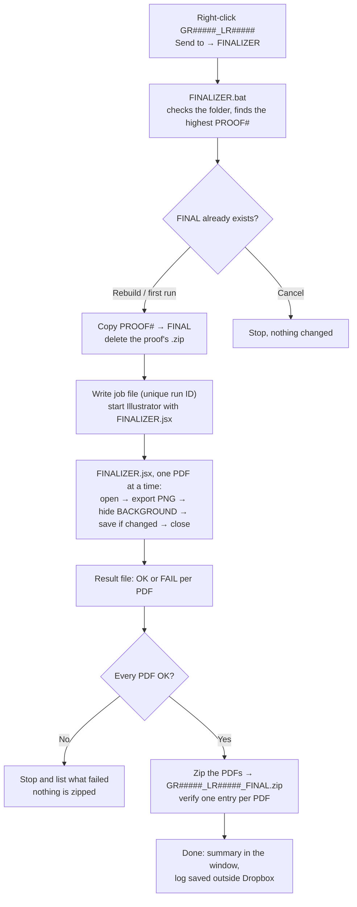

# FINALIZER Batch Suite

**One right-click turns an approved proof into a finished FINAL folder:** PNG exports, background layers hidden, and a ready-to-upload ZIP.


> ⚠️ **Built for one specific workflow.** It expects project folders named `GR#####_LR#####` that contain `PROOF#` folders of Illustrator PDFs on templates, with an optional layer named `BACKGROUND`. If your setup is similar, it's straightforward to adapt: see [Adapting it](#adapting-it).

---

## The problem

After a customer approves a proof, the Graphics team had to finalize the files by hand, for every job:

1. Copy the highest-numbered `PROOF#` folder and rename it `FINAL`
2. Delete the proof's `.zip` from the copy
3. Open every PDF in Illustrator
4. Export each one as a 72 ppi PNG on a white background
5. Hide the `BACKGROUND` layer wherever it's visible, then save and close
6. Zip the PDFs as `<project>_FINAL.zip`

That's repetitive, slow and easy to get slightly wrong.

## What FINALIZER does

Right-click the project folder and choose **Send to → FINALIZER**. A console window shows each step, and you end up with this:

```
GR58980_LR13694\FINAL\
  GR58980_LR13694_FC_V2.pdf     ← BACKGROUND layer hidden, same file name
  GR58980_LR13694_FC_V2.png     ← 72 ppi, white background, as the file looked when opened
  ...
  GR58980_LR13694_FINAL.zip     ← the PDFs only, checked to contain every one
```

Nothing else is created in `FINAL`. No log or flag files are left there, and no file names change.



## Built for a locked-down, Dropbox-based machine

- **No admin rights needed.** The installer only adds a shortcut to your own Send to menu. PowerShell is used only for inline commands, so no script execution policy has to change.
- **Dropbox-safe.** Saving and zipping retry automatically while Dropbox has a file locked. Copying uses `robocopy` with retries.
- **Nothing extra in Dropbox.** The log goes to `%LOCALAPPDATA%\FINALIZER\logs`. The hand-off files between the batch file and Illustrator go to `%TEMP%\FINALIZER`.

## Safety

| Risk | How v2 handles it |
|---|---|
| Other files open in Illustrator | Never touched. The script opens and closes only this job's PDFs. |
| Illustrator pop-ups (missing fonts, etc.) stalling the run | Suppressed for the run, then restored. |
| Illustrator hanging or never starting | Time limits: 3 minutes to start, 20 minutes to finish. Then it stops with a clear message. |
| A leftover file from an earlier run being mistaken for "done" | Every run has a unique ID, and only this run's result file counts. |
| A file failing in Illustrator | It's reported by name with the reason, and **nothing is zipped**. |
| `FINAL` already exists, for example from an older proof | You're asked whether to rebuild it from the highest proof or cancel. |
| Sending the wrong folder (a PROOF folder, FINAL...) | The name is checked against `GR…_LR…`, and you're asked before going on. |
| A file with more than one artboard | All artboards are kept when saving, and the file is flagged for a check. The PNG shows artboard 1. |
| Two runs at once | The second run asks before continuing. |

---

## Install

1. Download this repository (**Code → Download ZIP**) and unzip it to a folder you'll keep, for example `Documents\FINALIZER`.
2. Open the `src` folder and double-click **`INSTALL.bat`**. It adds **FINALIZER** to your right-click **Send to** menu.
3. That's it. Keep `FINALIZER.bat` and `FINALIZER.jsx` together in that folder, because the shortcut points there.

Illustrator is found automatically: the newest installed version is used. To pin a specific version, set `ILLUSTRATOR_EXE` at the top of `FINALIZER.bat`.

**To uninstall,** press **Win + R**, type `shell:sendto`, and delete the FINALIZER shortcut.

## Use

1. Make sure the proof is approved and the latest `PROOF#` folder is final.
2. Right-click the **`GR#####_LR#####`** project folder and choose **Send to → FINALIZER**.
3. Watch the window. Each PDF is listed as OK, or FAILED with the reason. The window closes itself 20 seconds after a successful run.

## Settings

These are at the top of `FINALIZER.bat`:

| Setting | Default | What it does |
|---|---|---|
| `ILLUSTRATOR_EXE` | *(blank = automatic)* | Full path to `Illustrator.exe`, if you want to pin a version |
| `TIMEOUT_MIN` | `20` | Minutes to wait for Illustrator to finish |
| `START_WAIT_SEC` | `180` | Seconds to wait for Illustrator to start the script |

## Adapting it

- **Folder names:** `PROOF` and `FINAL` are in `FINALIZER.bat`, in steps 2 and 4.
- **The layer to hide:** set `LAYER_NAME` at the top of `FINALIZER.jsx`.
- **PNG and PDF settings:** see `fzExportPng` and `fzSavePdf` in `FINALIZER.jsx`.

## Limits

- Illustrator opens only the **first page** of a multi-page PDF. Files are expected to be single-page templates.
- Folder paths containing `!` aren't supported, because of how Windows batch files read them.

---

## Files

```
src/
  FINALIZER.bat   orchestrator: folders, copying, waiting, zipping, log
  FINALIZER.jsx   Illustrator: open, export PNG, hide BACKGROUND, save, close
  INSTALL.bat     adds the Send to shortcut (no admin rights)
tests/
  jsx_harness.js  runs FINALIZER.jsx against a mocked Illustrator
```

Run the tests with Node.js: `node tests/jsx_harness.js`

## Changelog

### 2.0
A rewrite of v1, which had several failure modes that could go unnoticed.
- Illustrator now opens each PDF itself, one at a time. In v1 the batch file opened them all and could start processing before they had finished opening, which skipped files.
- Only this job's files are processed. v1 processed every document open in Illustrator.
- A unique run ID replaces the bare flag file. A leftover flag in v1 could cause unprocessed files to be zipped.
- Time limits replace waits that could last forever. Illustrator pop-ups are suppressed.
- Errors are reported per file, and nothing is zipped if any file fails. v1 hid every error.
- The ZIP is checked to contain every PDF.
- An existing `FINAL` prompts a rebuild. v1 silently reused it, even when it came from an older proof.
- All artboards are kept when saving. v1 kept artboard 1 only.
- `BACKGROUND` is found at any depth, including sublayers.
- Nothing extra is written to `FINAL`. The log moved outside Dropbox.
- Illustrator is found automatically, with a single install folder and a real `INSTALL.bat`.
- The `.ai` cleanup step is gone. It only existed to delete `.ai` copies that an early v1 build created by mistake, and v2 never creates them.

### 1.0
- Initial version: batch orchestration with Illustrator scripts and flag-file synchronization.

## About

I built this to remove a high-frequency manual step from a real production workflow. I spotted the bottleneck from years of doing the work by hand. The design keeps the human judgment (proof approval) and automates only the mechanical steps that follow.

**Next step (planned):** carry the automation past the FINAL folder. That means extracting colors from the output files, delivering files to the order and logo-registration systems, updating status in both, and routing exceptions to a person.

## License

MIT
